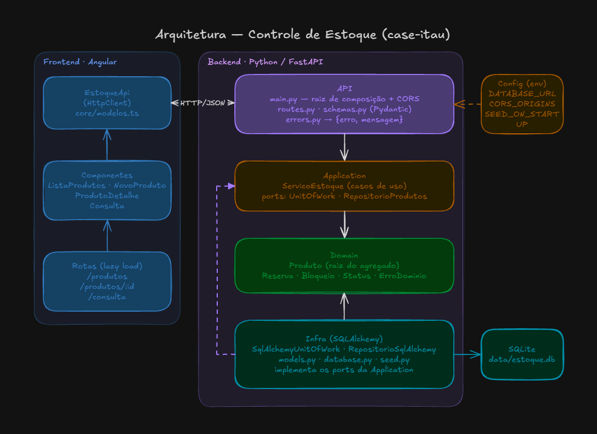
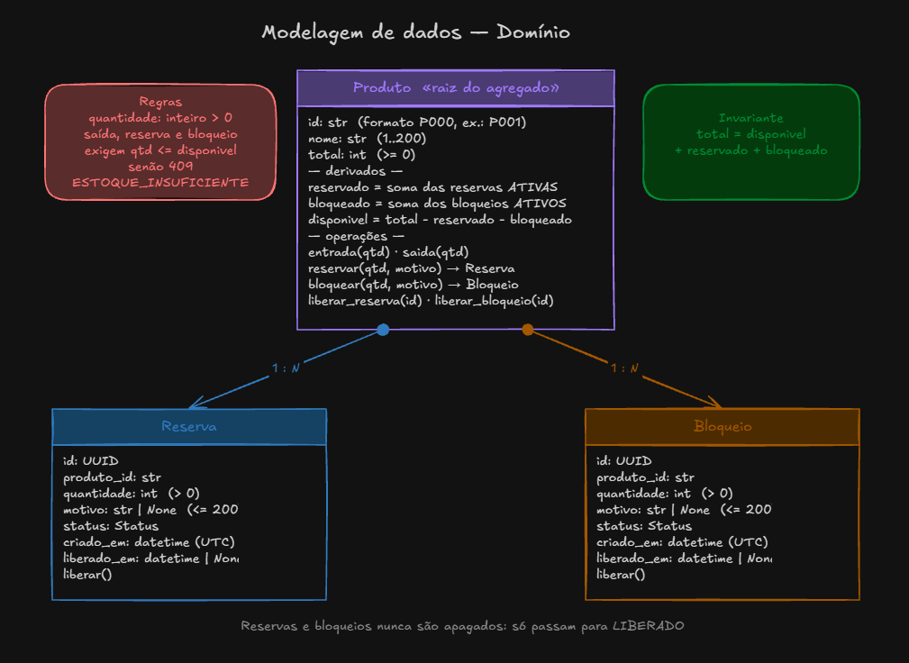
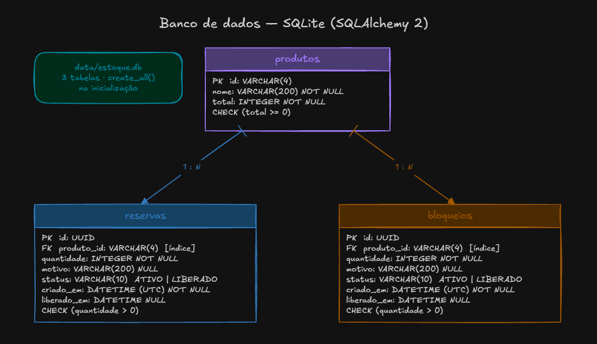
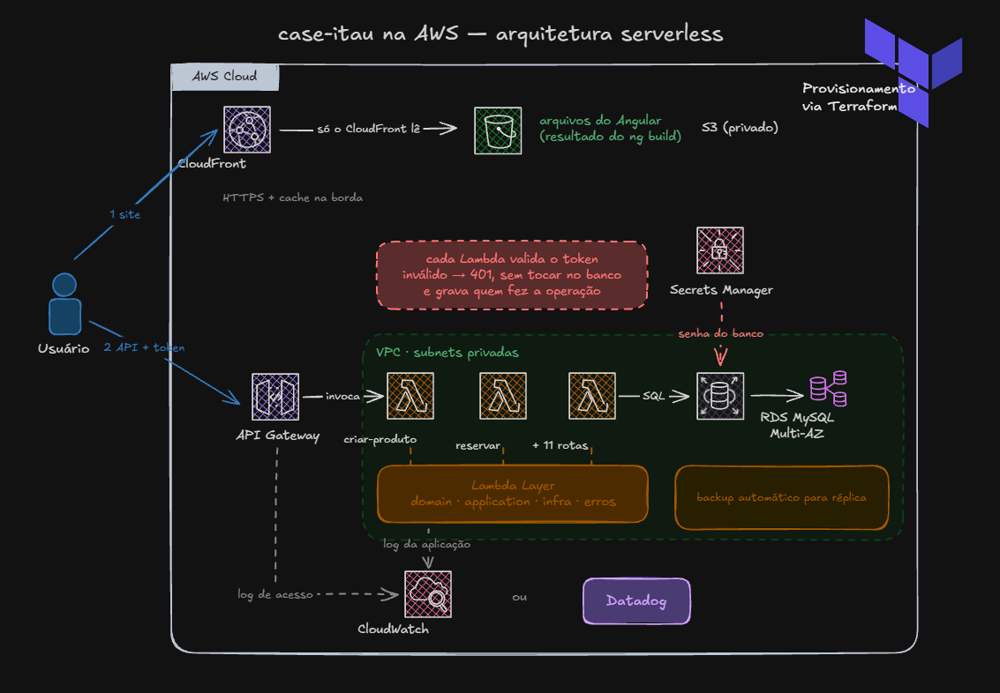

# Case Itaú (Controle de Estoque)

Este repositório contém a solução de um case técnico do processo seletivo para uma vaga de desenvolvedor júnior no Itaú. O desafio é criar um sistema de controle de estoque em que, para cada produto, dá para saber a quantidade total, disponível, reservada e bloqueada. Também precisa ser possível dar entrada e saída, reservar, bloquear, liberar reservas e bloqueios e consultar o produto, sem nunca deixar o estoque inconsistente.

O case podia ser feito em Java, C# ou Python, e foi escolhido **Python**. O backend é uma API REST feita com **FastAPI**, rodando no servidor **Uvicorn**. Os dados são validados com **Pydantic** e salvos num banco **SQLite**, acessado pelo **SQLAlchemy**. Os testes do backend usam **pytest**. O frontend foi feito em **Angular** com **TypeScript** e **Angular Material**, e os testes dele usam **Vitest**.

Link do projeto: https://case.audibert.dev

Link do Swagger: https://case.audibert.dev/api/docs

## Sumário

- [1. Visão geral](#1-visão-geral)
- [2. Arquitetura e estrutura](#2-arquitetura-e-estrutura)
- [3. Principais decisões técnicas](#3-principais-decisões-técnicas)
- [4. Premissas](#4-premissas)
- [5. Limitações conhecidas](#5-limitações-conhecidas)
- [6. Como executar](#6-como-executar)
- [7. Em um ambiente real de produção](#7-em-um-ambiente-real-de-produção)
- [8. Visão de engenharia](#8-visão-de-engenharia)
- [Considerações finais](#considerações-finais)

## 1. Visão geral

### O problema

Imagine o estoque de uma loja. Nem toda unidade que está na prateleira pode ser vendida:

- algumas já foram **reservadas** para pedidos de clientes;
- outras estão **bloqueadas**, por exemplo por defeito ou porque estão em conferência.

Por isso, além da quantidade **total**, o sistema precisa saber quanto está **disponível** de verdade. Um mesmo produto pode ter várias reservas e vários bloqueios ativos ao mesmo tempo, cada um vindo de uma solicitação diferente, e cada reserva ou bloqueio precisa ter um id para ser consultado e liberado depois.

Exemplo: um teclado tem 100 unidades no total, 15 reservadas para dois pedidos e 8 bloqueadas por avaria. Sobram 77 disponíveis, e nenhuma operação pode usar mais do que essas 77.

### O que o case pede

As funcionalidades pedidas são:

| Funcionalidade | O que faz |
|---|---|
| Entrada | Adiciona unidades ao estoque de um produto |
| Saída | Retira unidades, se houver quantidade disponível suficiente |
| Reservar | Separa unidades para um pedido; a reserva ganha um id para ser consultada e liberada depois |
| Bloquear | Deixa unidades indisponíveis (ex.: produto com defeito); o bloqueio também ganha um id |
| Liberar | Cancela uma reserva ou um bloqueio, e as unidades voltam a ficar disponíveis |
| Consultar | Mostra o total, o disponível, o reservado e o bloqueado de um produto |

O projeto tem duas partes:

- **Backend:** a API REST, com a documentação interativa (Swagger) em `/docs`.
- **Frontend:** uma tela em Angular que usa todas as rotas da API.

A regra mais importante é que o estoque nunca fique errado. Não dá para tirar, reservar ou bloquear mais do que está disponível, e uma operação que dá erro não muda nada. A conta abaixo precisa fechar sempre:

```
total = disponível + reservado + bloqueado      (e nenhum valor fica negativo)
```

O enunciado não exige uma arquitetura, um framework ou um banco de dados específico: essas escolhas ficam a critério do candidato, desde que sejam explicadas. Além do código, a entrega precisa ter:

- **testes automatizados** que mostrem que a solução funciona;
- **este README**, com a arquitetura, as decisões, as premissas, as limitações e como executar;
- **o uso de IA**, com os principais prompts e uma análise de onde a IA ajudou, o que eu mudei nas sugestões dela e os erros que ela cometeu;
- **os 5 aspectos** que considero mais importantes para a qualidade e a evolução da solução.

A avaliação olha principalmente para a modelagem do problema, a correção das regras, a qualidade do código e dos testes, o tratamento de erros e a capacidade de explicar as decisões. O próprio enunciado diz que uma solução simples e bem justificada pode ser melhor avaliada do que uma complexa sem necessidade. Por isso, sempre que possível, escolhi o caminho mais simples.

### Uso de IA

O case permite e incentiva o uso de ferramentas de IA durante todo o desenvolvimento, como **GitHub Copilot**, **ChatGPT**, **Claude** e **Gemini**. Não há penalidade pelo uso intensivo, mas o candidato precisa entender, explicar e defender todo o código entregue, tenha ele sido escrito à mão ou com ajuda da IA.

Neste projeto usei o **Claude Code** e **Claude Desktop** como auxiliar no desenvolvimento. Ele foi guiado pelo arquivo [`CLAUDE.md`](CLAUDE.md), que fica na raiz do repositório e descreve o contexto do case, a stack, a arquitetura, as regras de negócio e a ordem de trabalho que a IA devia seguir. Mais detalhes em [`docs/uso-de-ia.md`](docs/uso-de-ia.md).

## 2. Arquitetura e estrutura

O projeto é um **monólito**, ou seja, uma única aplicação. Dentro dela, o código é dividido em **camadas**, cada uma com uma responsabilidade:

| Camada | O que faz |
|---|---|
| `domain/` | As regras de negócio: o `Produto`, a `Reserva`, o `Bloqueio` e os erros (ex.: `EstoqueInsuficiente`). É Python puro, sem FastAPI nem banco de dados. |
| `application/` | Os casos de uso, como "reservar" e "dar saída". Cada um busca o produto, chama a regra e salva o resultado. |
| `infra/` | Tudo que fala com o banco de dados: tabelas, consultas e o seed (dados iniciais). |
| `api/` | As rotas HTTP, a validação dos dados recebidos e a conversão dos erros em respostas HTTP. |

A ideia principal é que **as regras de negócio não dependem de nada externo**. A camada `domain/` não sabe que existe FastAPI ou banco de dados. Assim, as regras podem ser testadas sozinhas, e trocar o banco ou o framework não muda nada nelas.



Todas as alterações de estoque passam por métodos do `Produto` (`entrada`, `saida`, `reservar`, `bloquear`, `liberar_reserva`, `liberar_bloqueio`). É ali que as regras são conferidas. Cada operação segue sempre o mesmo caminho:

```
abre transação → busca o produto → aplica a regra → salva → confirma (commit)
                                    se der erro → desfaz tudo (rollback)
```

### Modelagem

O `Produto` tem várias `Reservas` e vários `Bloqueios`. No produto fica guardado só o `total`; o reservado, o bloqueado e o disponível são calculados a partir das reservas e dos bloqueios ativos.



No banco, isso vira três tabelas: `produtos`, `reservas` e `bloqueios`. As reservas e os bloqueios apontam para o produto pelo `produto_id`.



### Estrutura de pastas

```
backend/
  src/estoque/
    domain/        produto.py, exceptions.py
    application/   services.py, ports.py
    infra/         models.py, repository.py, uow.py, database.py, seed.py
    api/           main.py, routes.py, schemas.py, errors.py
    config.py
  tests/
    unit/          testes das regras e dos casos de uso, sem banco
    integration/   testes das rotas da API com um banco em memória
frontend/          Angular 21 + Angular Material
docs/              decisões, respostas da API e uso de IA
```

## 3. Principais decisões técnicas

**Por que um monólito?**
O sistema é pequeno e trata de um único assunto: o estoque. Dividir em vários serviços (microsserviços) exigiria comunicação pela rede e mais de um deploy, sem trazer benefício para um projeto desse tamanho. Como o código já está separado em camadas, dá para separar partes dele no futuro se for preciso.

**Por que Python e FastAPI?**
Python é a linguagem que eu mais domino entre as três permitidas. Escolhi o FastAPI porque ele:
- valida os dados recebidos automaticamente;
- gera a documentação da API (Swagger) sozinho;
- facilita escrever testes das rotas.

**Por que SQLite?**
O SQLite não precisa de instalação: o banco é só um arquivo, criado automaticamente quando a API sobe. Isso deixa o projeto fácil de rodar, sem precisar configurar nada. Mesmo assim, é um banco relacional de verdade, com transações. O acesso ao banco é feito pelo SQLAlchemy, então trocar por PostgreSQL seria basicamente mudar a URL de conexão.

**Só o total é guardado; o resto é calculado.**
No banco eu guardo apenas o `total` de cada produto, junto com as reservas e os bloqueios. Os outros valores são calculados na hora:
- `reservado` = soma das reservas ativas
- `bloqueado` = soma dos bloqueios ativos
- `disponível` = total − reservado − bloqueado

Se eu guardasse o reservado numa coluna separada, ele poderia ficar diferente da soma real das reservas por causa de algum bug. Calculando, os números sempre batem.

**Validar tudo antes de alterar.**
As regras primeiro conferem tudo (quantidade válida, estoque suficiente) e só depois alteram alguma coisa. Além disso, cada operação roda dentro de uma transação: se acontecer qualquer erro, o banco desfaz tudo. Assim, uma operação inválida nunca deixa o estoque pela metade.

**Liberar não apaga a reserva.**
Quando uma reserva ou bloqueio é liberado, ele não é apagado. O status muda para `LIBERADO` e a data da liberação é guardada, para manter o histórico. Tentar liberar a mesma reserva duas vezes devolve um erro (`409`), para quem chamou saber que a segunda vez não fez nada.

**A saída só usa o disponível.**
Unidades reservadas ou bloqueadas não podem sair do estoque. Por exemplo: com 100 no total e 23 reservadas ou bloqueadas, dá para tirar no máximo 77.

**Erros sempre no mesmo formato.**
Cada regra quebrada tem um erro próprio, e todos chegam ao cliente no mesmo formato:

```json
{ "erro": "ESTOQUE_INSUFICIENTE", "mensagem": "Estoque insuficiente: foram solicitadas 100 unidades, mas só há 77 disponíveis." }
```

O código HTTP segue um padrão:
- **404:** algo não foi encontrado;
- **409:** a operação não pode ser feita no estado atual (ex.: falta estoque);
- **422:** os dados enviados são inválidos.

O frontend só mostra a `mensagem` que a API devolve e não repete nenhuma regra.

**Formato do id do produto.**
O id é escolhido por quem cadastra o produto e precisa seguir o formato `P` + 3 números (ex.: `P001`). Já os ids de reservas e bloqueios são gerados pela API (UUID).

**Testes.**
O backend tem 1079 testes, divididos em três grupos:
- **Testes unitários:** testam cada regra sozinha, sem banco de dados.
- **Testes de integração:** chamam as rotas da API de verdade, com um banco em memória, e conferem a resposta e se o estoque continua certo depois de um erro.
- **Testes de sequência:** executam várias operações seguidas e conferem, depois de cada uma, que `total = disponível + reservado + bloqueado` e que nada ficou negativo.

**Funciona sem configurar nada.**
As configurações (banco, CORS e seed) vêm de variáveis de ambiente, mas todas têm um valor padrão. Na primeira vez que a API sobe, ela cria dois produtos de exemplo (seed). O seed usa as mesmas operações da API, então passa pelas mesmas regras.

## 4. Premissas

São as suposições que fiz onde o enunciado não deixava claro:

- O produto precisa ser cadastrado antes de receber entrada. A entrada não cria o produto sozinha.
- Toda quantidade precisa ser um número **inteiro maior que zero**. Valores como `"5"` (texto) ou `5.0` são recusados.
- Reservar e bloquear só usam unidades **disponíveis**. Não dá para reservar algo que já está bloqueado.
- Reserva e bloqueio funcionam do mesmo jeito; o que muda é o significado. Reserva é separar para um pedido; bloqueio é deixar indisponível, por exemplo por defeito. Os dois aceitam um `motivo` opcional.
- Para tirar do estoque algo que está reservado, primeiro se libera a reserva e depois se faz a saída.
- Reservas e bloqueios não expiram: ficam ativos até alguém liberar.
- Não existe login: qualquer pessoa que acessa a API pode fazer qualquer operação.

## 5. Limitações conhecidas

- **Sem login.** A API é aberta, e não fica registrado quem fez cada operação.
- **Não dá para excluir nem editar um produto.** Depois de cadastrado, o produto não pode ser removido, e o nome não pode ser alterado.
- **No máximo 1000 produtos.** O formato do id (`P000` a `P999`) limita a quantidade.
- **Entradas e saídas não ficam no histórico.** Só as reservas e os bloqueios ficam guardados. Não dá para ver, por exemplo, quando foi feita cada entrada.
- **O SQLite não aguenta muitos acessos.** Ele grava uma coisa por vez, então serve para o case, mas não para muitos usuários ao mesmo tempo.
- **Listas sem paginação.** As listas de produtos, reservas e bloqueios voltam inteiras, de uma vez só.
- **Fica mais lento com o tempo.** Toda operação carrega todas as reservas e bloqueios do produto, inclusive os já liberados. Com muitos registros, isso fica mais lento.
- **Mudar as tabelas exige apagar o banco.** Não há ferramenta de migração. Se a estrutura das tabelas mudar, é preciso apagar o arquivo do SQLite e deixar a API criar de novo.

## 6. Como executar

### Pré-requisitos

- Python 3.12 ou mais recente
- Node.js 20.19+, 22.12+ ou 24+ e npm (só para o frontend)

### Backend

Dentro da pasta `backend/`:

```bash
python -m venv .venv
source .venv/bin/activate          # no Windows: .venv\Scripts\activate
pip install -r requirements.txt
uvicorn estoque.api.main:app --reload --app-dir src
```

- API: http://localhost:8000
- Swagger (documentação interativa): http://localhost:8000/docs
- Todas as rotas, respostas e erros explicados: [`docs/api.md`](docs/api.md)

Na primeira vez, o banco `data/estoque.db` é criado com dois produtos de exemplo:

| Produto | Total | Reservado | Bloqueado | Disponível |
|---|---|---|---|---|
| `P001` — Teclado mecânico | 100 | 15 (reservas de 10 e 5) | 8 | 77 |
| `P002` — Mouse sem fio | 50 | 0 | 0 | 50 |

Para começar do zero, apague o arquivo `backend/data/estoque.db`.

### Testes do backend

Dentro da pasta `backend/`, com o ambiente virtual ativado:

```bash
pytest
```

Os testes usam um banco em memória, então não mexem no `estoque.db`.

### Frontend

Dentro da pasta `frontend/`, com a API já rodando:

```bash
npm install
npm start
```

- Aplicação: http://localhost:4200
- O endereço da API fica em `src/environments/environment.ts`.
- Para rodar os testes do frontend: `npm test`

### Configurações (opcionais)

Nada precisa ser configurado para rodar localmente. Se quiser mudar algo, defina estas variáveis de ambiente:

| Variável | Padrão | Para que serve |
|---|---|---|
| `DATABASE_URL` | `sqlite:///./data/estoque.db` | Endereço do banco de dados |
| `CORS_ORIGINS` | `http://localhost:4200` | Sites que podem chamar a API (separados por vírgula) |
| `SEED_ON_STARTUP` | `true` | Cria os produtos de exemplo se o banco estiver vazio |

## 7. Em um ambiente real de produção

O projeto foi feito para rodar no computador. Se ele fosse usado de verdade, com muitos usuários, eu mudaria algumas coisas. Pensei num cenário na AWS em que o estoque vira um **microsserviço serverless**: cada rota da API é uma função Lambda, há login de usuários e todos os acessos ficam registrados.

### Visão geral

A imagem abaixo mostra a arquitetura completa na AWS. Toda essa infraestrutura seria criada com **Terraform**, ou seja, descrita em código em vez de criada clicando no console da AWS. Assim, o ambiente pode ser recriado e revisado como qualquer outro código.



O caminho de uma requisição, seguindo a imagem:

1. O usuário abre o site. O **CloudFront** entrega os arquivos do Angular, que ficam guardados no **S3**.
2. O Angular chama a API pelo **API Gateway**, mandando o token do usuário em cada requisição.
3. O API Gateway chama a **Lambda** daquela rota.
4. A Lambda **valida o token**. Se ele for inválido, a resposta é `401`, sem nem acessar o banco.
5. Com o token válido, a Lambda faz a operação e grava no **MySQL**, usando a senha guardada no **Secrets Manager**.
6. O acesso e o que a Lambda fez ficam registrados no **CloudWatch** ou no **Datadog**.

### Frontend: S3 + CloudFront

- O resultado do `ng build` (HTML, JavaScript e CSS) vai para um bucket **S3 privado**. Ninguém acessa o bucket direto: só o CloudFront tem permissão de ler os arquivos.
- O **CloudFront** entrega o site com HTTPS e guarda os arquivos em cache em servidores perto do usuário, o que deixa o carregamento mais rápido.
- O endereço da API já fica no `environment.ts`, então basta trocar pela URL do API Gateway no build de produção.

### Autenticação: token validado pela Lambda

- Toda chamada à API leva um **token** (JWT) do usuário, no header `Authorization`.
- **Cada Lambda valida o token** antes de fazer qualquer coisa: confere se ele é verdadeiro (assinatura) e se não expirou. Se o token for inválido ou estiver faltando, a resposta é `401` e o banco nem é acessado.
- O código que valida o token fica na **Lambda Layer** (ver abaixo), junto com o resto do código comum. Assim, ele é escrito uma vez só e usado pelas 13 funções.
- O token também diz **quem** é o usuário e **o que ele pode fazer**. Por exemplo:
  - `consulta`: só pode consultar (rotas `GET`);
  - `operador`: pode fazer entrada, saída, reserva, bloqueio e liberação;
  - `admin`: também pode cadastrar produtos.
- A Lambda grava quem fez cada operação. Isso resolve a limitação de não saber quem fez o quê.

### API: API Gateway + uma Lambda por rota

Cada rota da API vira uma função Lambda separada:

| Rota | Lambda |
|---|---|
| `POST /produtos` | `estoque-criar-produto` |
| `GET /produtos` | `estoque-listar-produtos` |
| `GET /produtos/{produto_id}` | `estoque-consultar-produto` |
| `POST /produtos/{produto_id}/entradas` | `estoque-entrada` |
| `POST /produtos/{produto_id}/saidas` | `estoque-saida` |
| `POST /produtos/{produto_id}/reservas` | `estoque-reservar` |
| ... | uma para cada uma das 13 rotas |

Escolhi uma Lambda por rota porque:

- **Cada função tem só a permissão de que precisa.** Por exemplo, a Lambda de consulta pode ter acesso só de leitura ao banco.
- **Cada função escala sozinha.** Se as reservas tiverem muito mais acesso que o cadastro de produtos, só a Lambda de reserva ganha mais cópias rodando.
- **Um erro numa rota não derruba as outras**, e dá para atualizar uma rota sem mexer nas demais.
- **Cada função é pequena**, então carrega mais rápido na primeira chamada (o chamado *cold start*).

**Como o código atual seria reaproveitado.** Aqui a separação em camadas faz diferença:

- `domain/` e `application/` **não mudam nada**. As regras de negócio e os casos de uso continuam os mesmos.
- `infra/` muda só a conexão, de SQLite para MySQL.
- `api/` é a única parte reescrita. No lugar das rotas do FastAPI, cada Lambda tem um *handler*, uma função pequena que lê a requisição, chama o `ServicoEstoque` e devolve a resposta.

O código comum, ou seja, o domínio, os casos de uso, o acesso ao banco, a validação do token e a conversão dos erros no formato `{erro, mensagem}`, ficaria numa **Lambda Layer**, um pacote compartilhado por todas as funções. Assim, as regras não ficam copiadas em 13 lugares.

### Banco de dados: RDS MySQL

- O banco fica numa **rede privada** (VPC), sem acesso pela internet. Só as Lambdas, que rodam na mesma rede, conseguem falar com ele.
- **Secrets Manager:** guarda a senha do banco, que deixa de ficar no código ou em variável de ambiente.
- **Backup automático** e **Multi-AZ**, que mantém uma réplica do banco em outro data center para o caso de falha.
- **Histórico de movimentações:** uma tabela nova registra toda entrada, saída, reserva, bloqueio e liberação, com quem fez e quando.

**Requisições ao mesmo tempo.** Com Lambdas, várias cópias da API rodam juntas, então o problema de duas reservas simultâneas passa a acontecer de verdade. No MySQL, a solução é "travar" a linha do produto no começo da operação com `SELECT ... FOR UPDATE`. A segunda requisição espera a primeira terminar e então lê o saldo já atualizado.

### Logs e monitoramento: CloudWatch ou Datadog

Os registros ficam em três lugares, cada um com um objetivo:

| Registro | Quem gera | O que guarda |
|---|---|---|
| **Log de acesso** | API Gateway | Quem chamou, qual rota, o status da resposta e quanto tempo levou |
| **Log da aplicação** | Cada Lambda | O que aconteceu, por exemplo "usuário X reservou 10 unidades do P001", além de erros e avisos |
| **Histórico de movimentações** | Banco de dados | Toda operação no estoque, para consulta e auditoria |

O histórico fica no banco, e não só no log, porque é informação do negócio: precisa poder ser consultado a qualquer momento e não pode se perder quando o log expira.

Para os logs, há duas opções:

- **CloudWatch:** já vem integrado com o API Gateway e as Lambdas, sem configuração extra. Dá para criar alarmes, por exemplo quando aparecem muitos erros `500` ou as respostas ficam lentas.
- **Datadog:** junta logs, métricas e rastreamento das requisições num painel só, com buscas mais fáceis. É pago à parte e precisa de uma extensão instalada nas Lambdas.


## 8. Visão de engenharia

Os 5 aspectos que considero mais importantes para a qualidade, a eficiência, a confiabilidade e a evolução desta solução:

### 1. Regras de negócio corretas e num lugar só

Num controle de estoque, um erro de regra (como deixar reservar mais do que existe) gera prejuízo real: venda de produto que não existe, cliente sem entrega. Por isso, todas as regras ficam na camada `domain/`, e toda alteração de estoque passa pelos métodos do `Produto`. Assim, nenhuma rota, tela ou script consegue "pular" uma regra, e quando uma regra muda, ela muda num lugar só.

### 2. Testes automatizados

Os testes são o que me dá segurança para mudar o código sem quebrar o que já funcionava. Neste projeto isso foi testado na prática: quando removi o controle de concorrência, os testes mostraram na hora tudo o que dependia dele. Além de testar cada regra e cada rota, os testes de sequência de operações conferem, depois de cada passo, que `total = disponível + reservado + bloqueado`, o que pega erros que um teste isolado não pegaria.

### 3. Consistência dos dados

Uma operação nunca pode deixar o estoque pela metade. Hoje isso é garantido de três formas: as regras validam tudo antes de alterar, cada operação roda numa transação (se der erro, o banco desfaz tudo), e os saldos são calculados em vez de guardados em colunas separadas, então não há como ficarem diferentes entre si. Num ambiente real, o próximo passo seria tratar requisições simultâneas no mesmo produto (ver [seção 7](#7-em-um-ambiente-real-de-produção)).

### 4. Observabilidade e histórico

Em produção, quando algo dá errado, é preciso conseguir responder "o que aconteceu, quando e quem fez". Para isso são necessários logs de acesso, logs da aplicação, alertas e um histórico completo das movimentações do estoque. Hoje essa é uma das principais [limitações](#5-limitações-conhecidas) do projeto, e é uma das primeiras coisas que eu resolveria antes de colocá-lo em uso real.

### 5. Código organizado para evoluir

O sistema vai mudar: novos requisitos, outro banco de dados, outra forma de rodar (como Lambdas). A separação em camadas faz com que essas mudanças fiquem nas pontas. Trocar o SQLite pelo MySQL mexe só na `infra/`, e trocar o FastAPI por Lambdas mexe só na `api/`, sem tocar nas regras de negócio. Junto com isso, manter a solução simples, sem tecnologias desnecessárias, deixa o código mais fácil de entender para quem chegar depois.

## Considerações finais

A ideia deste projeto foi resolver o problema do enunciado de forma **simples e bem organizada**, em vez de colocar mais tecnologias ou funcionalidades do que o necessário. Em resumo, a solução entrega:

- todas as funcionalidades pedidas: entrada, saída, reserva, bloqueio, liberação e consulta;
- regras de negócio que mantêm o estoque sempre certo (`total = disponível + reservado + bloqueado`, sem valores negativos), com uma operação inválida nunca alterando nada;
- código separado em camadas, com as regras de negócio isoladas do framework e do banco de dados;
- testes automatizados para cada regra, cada rota e para sequências de operações;
- erros padronizados, com mensagens em português;
- um frontend simples para usar a API sem precisar de ferramentas extras.

Também procurei ser transparente sobre o que ficou de fora: as [limitações](#5-limitações-conhecidas) mostram o que a solução ainda não cobre, e a [seção 7](#7-em-um-ambiente-real-de-produção) mostra como eu evoluiria o projeto para um ambiente real.

Para mais detalhes:

- [`docs/api.md`](docs/api.md): todas as rotas, respostas e erros da API;
- [`docs/uso-de-ia.md`](docs/uso-de-ia.md): como a IA foi usada no desenvolvimento.

Obrigado pela oportunidade e pelo tempo dedicado à avaliação. Fico à disposição para explicar qualquer decisão ou discutir alternativas.
